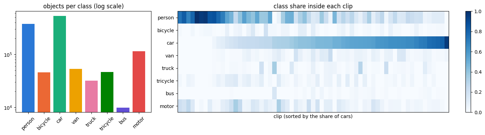
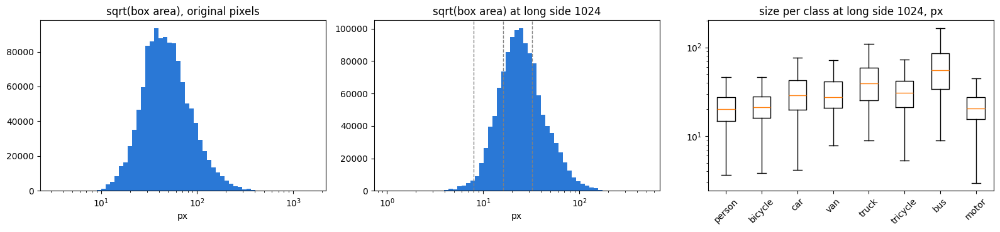
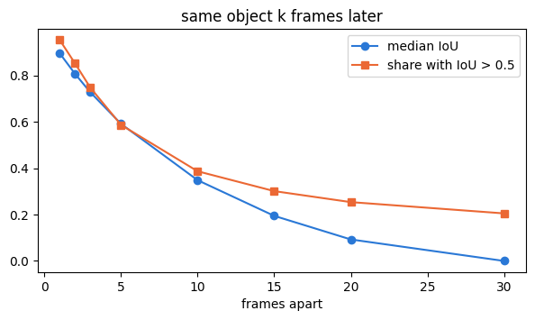
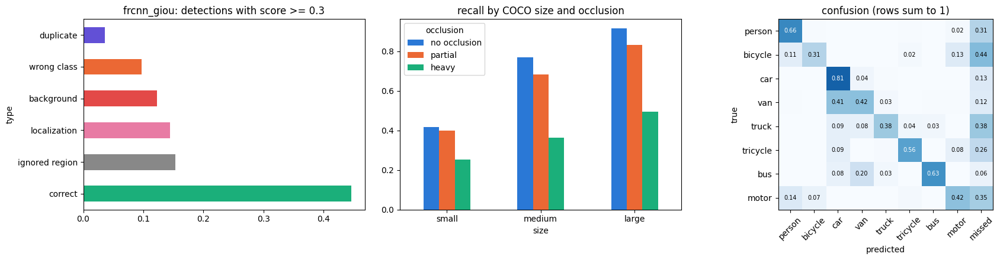
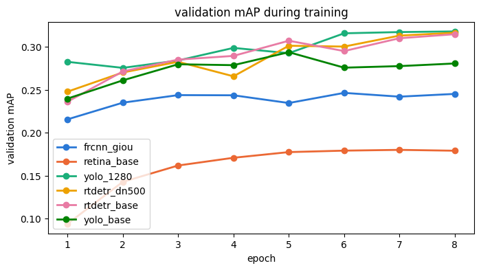
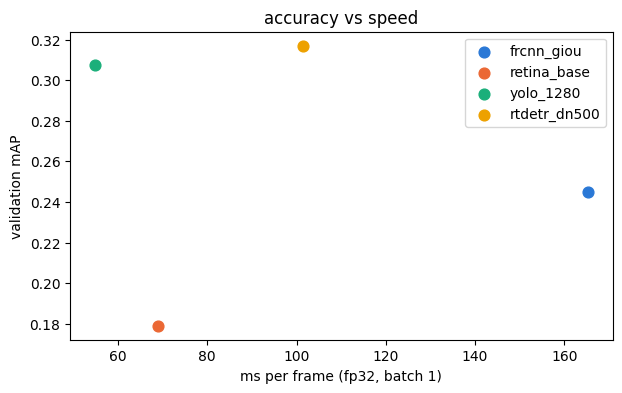
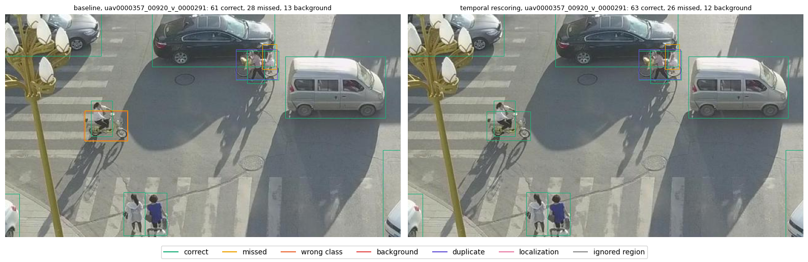

## Data Preparation:
As for data preprocessing we did several things, here is what we did basing on our finding:
### EDA finding: 
1. Dataset: 63 clips, 27047 frames, 8 classes, we merged the classes: pedestrian and people became person, tricycle and awning tricycle became tricycle, others became ignored.
2. Class imbalance: car 44 %, person 31 %, motor 9 %, van 4 %, bicycle 4 %, tricycle 4 % , truck 3 %, bus 0.8 %, So we decidet to report the AP for each class and than choose a hold-out with similar class shares, to make the valid validation

2. Objects are really tiny, median is close to 24 px at a long side of the image = 1024. What we did: the input size = 1024, also later tested at 1280

3. Number of objects: there are as much as 180 objects in one frame, so the usual limit of 100 detections would cut real objects, and 500 is the limit that the competition metric uses
4. Similarity of frames: most of the frames are similar with very small change, an example: a same objects 0.89 of itself after 1 frame, at 2 frames it is 0.81, and 0.35 by every 10th, so, we trained on every 10th frame of clip

### Ignored regions:
We painted the ignored images to gray, so that the model wouldn't be puhished if it found objects in that region, and also, in evaluation marked it with iscrowd so that the detection does not counts the objects there. Also labels that are more than half inside an ignored region were removed from training

### Label conversion

Labels were converted to YOLO format, and all frameworks used them
They were checked by drawing the boxes back on frames

### Resizing:
For torchvision modelseach frame is scaled so its longer side is 1024 pixels, and the shorter side is resized also so that it would be of the same shape.

Ultralytics models use letterbox (the frame is scaled down to fit inside a 1024 square, and the empty strips are filled with gray)

## Validation:
We validated on the whole clips the model never saw during training. We did it because frames from one clip look almost the same, so if we wuild split by frame, the model would see frames almost identical to training clips during validation. The test set is made of new clips too, so a split by clip copies the real situation.

### Split
GroupKFold with 5 folds, grouped by clip, so each clip lands entirely in one fold. One fold  whose class shares were closest to the pther data, 
became the hold-out (13 clips, 551 frames). For the final submission, the model was retrained on all 63 clips.

### Evaluation
For evaluation we used COCO mAP. The evalutaion scores were assigned with use he original frame size, so every model is judged the same way, doesnt matter what input size it used.

### Decision to leave the change: 
We did only one change at a time, kept only if hold-out mAP went up. The seed noise is 0.0067 mAP, so smaller gain of change could have been just a lucky thing.

## Models

### Two-stage Anchor-based
Faster R-CNN.
We have chosen the ResNet-50 FPN v2, in a nutshell it works in 2 stages: first it proposes regions, and than in the 2nd stage it classifies them

Baseline was 0.2339, and after trying different approaches we chose adding more RPN proposals and GIoU loss, that gave the mAP if 0.2451

The problem with it was that 26% of small objects were never proposed in the first stage, so they were skipped by model right away

| Run | mAP | AP50 | AP small | ms per frame |
|---|---|---|---|---|
| Baseline | 0.2339 | 0.4600 | 0.0394 | 116 |
| More RPN proposals (kept) | 0.2409 | 0.4706 | 0.0431 | 165 |
| 50 % positive RoIs (dropped) | 0.2373 | 0.4731 | 0.0433 | 165 |
| GIoU loss (kept) | 0.2451 | 0.4881 | 0.0502 | 165 |

### One-stage Anchor-based

We have chose the RetinaNet (ResNet-50 FPN v2). It is one stage Anchor-based model, so it uses anchors + focal loss, and has no proposal stage. It is the worst of 4 models, the baseline was 0.1790, and it was its best result. 

We tried several approaches: anchors fitted to the data, lower IoU, thresholds and NWD loss and all made it worse.

| Run | mAP | AP50 | AP small |
|---|---|---|---|
| Baseline (best) | 0.1790 | 0.3388 | 0.0261 |
| Anchors from data, 16 to 256 px | 0.1368 | 0.3029 | 0.0354 |
| Lower IoU thresholds 0.4 / 0.3 | 0.1454 | 0.2704 | 0.0189 |
| NWD loss | 0.1763 | 0.3403 | 0.0234 |

The problem with it is that it finds only 19 percent of small objects against 40% for Faster R-CNN.

### One-stage Anchor-free

For this we have Chosen YOLO26m. It is one stage, anchor free, and fast, only 34ms per frame on 2xT4 GPUs

Results: Baseline was 0.2710 at 1024 size. Input 1280 raised it to 0.3074, the P2 head gave only 0.2777 and was slower.

| Run | mAP | AP50 | AP small | ms per frame |
|---|---|---|---|---|
| Baseline 1024 | 0.2710 | 0.5166 | 0.0628 | 34 |
| Input 1280 (kept) | 0.3074 | 0.5770 | 0.0825 | 55 |
| P2 head | 0.2777 | 0.5532 | 0.0773 | 78 |

The problem with it, is that in input size 1024, 70% of objects were smaller that the one grid cell of the model (32px)

### Query-based

For this we have chosen RT-DETR-l. It is a transformer detector: it ahs a CNN backbone, than a transformer decoder with set of querries, and each querry than predicts at most one object. During training its predictions are being matched to objects on to one, so there are only 1.9 % duplicates, thats why it almost doesn't need NMS.

Results: Baseline with 300 queries: 0.3109, 500 queries: 0.3123, 500 queries + 500 denoising queries: 0.3170, the best of all four models

| Run | mAP | AP50 | AP small | ms per frame |
|---|---|---|---|---|
| Baseline, 300 queries | 0.3109 | 0.5777 | 0.0852 | 101 |
| 500 queries | 0.3123 | 0.5826 | 0.0875 | 101 |
| 500 queries + 500 denoising queries | 0.3170 | 0.5949 | 0.0929 | 102 |

## Our pipeline
The idea was to use RT-DETR to find the boxes, and than the metamodel that will decide how much to trust each box using the neighbour frames and agreement with other models.

The realization of our pipeline is following:

- Input: test frames are being resized so that theirs long side is 1280
- Detection: RT-DETR-l (500 queries, 500 denoising queries, trained on all 63 clips)
- Other detectors: Faster R-CNN, RetinaNet and YOLO also run on the same frame. For each RT-DETR box, we recorded whether they found the same object and with what score.
- Temporal features: we used RT-DETR boxes on whole clip and than linked them into tracks with Hungarian matching on IoU. Each box gets the track mean score over window of 10 frams and short gaps in tracks are filled.
- Metamodel: we have trained the metamodel (we chose te simpliest logistic regression) that takes features of each box and than outputs the final score the score of RT-DETR, temporal score, and scores from other detectors
- Ouput: boxes are scaled back to the original frame size and written to the submission file

## Results

### All detectors under the shared protocol

Hold-out mAP 0.50:0.95 on 551 frames of 13 clips, input 1024 (YOLO 1280), 8 epochs, ms per frame at fp32, batch 1.

| Model | mAP | AP50 | AP small | AP medium | AP large | ms per frame |
|---|---|---|---|---|---|---|
| Faster R-CNN, GIoU | 0.2451 | 0.4881 | 0.0502 | 0.2244 | 0.3523 | 165 |
| RetinaNet, baseline | 0.1790 | 0.3388 | 0.0261 | 0.1529 | 0.2828 | 69 |
| YOLO26m, input 1280 | 0.3074 | 0.5770 | 0.0825 | 0.3036 | 0.3919 | 55 |
| RT-DETR-l, dn500 | 0.3170 | 0.5949 | 0.0929 | 0.3052 | 0.4151 | 102 |

AP per class:

| Model | person | bicycle | car | van | truck | tricycle | bus | motor |
|---|---|---|---|---|---|---|---|---|
| Faster R-CNN | 0.216 | 0.084 | 0.459 | 0.233 | 0.194 | 0.242 | 0.402 | 0.134 |
| RetinaNet | 0.162 | 0.029 | 0.429 | 0.094 | 0.093 | 0.118 | 0.436 | 0.073 |
| YOLO26m | 0.275 | 0.107 | 0.513 | 0.281 | 0.245 | 0.321 | 0.508 | 0.213 |
| RT-DETR-l | 0.257 | 0.135 | 0.526 | 0.316 | 0.270 | 0.300 | 0.538 | 0.200 |

### Pipeline experiments

| Step | Type of change | Hold-out mAP | Public score | Kept |
|---|---|---|---|---|
| RT-DETR dn500 (start point) | model | 0.3170 | - | yes |
| Every 5th frame instead of every 10th | data | 0.2904 | - | no |
| 2 times more epochs | model | 0.3065 | - | no |
| AdamW, lr 1e-4 | model | 0.2735 | - | no |
| Train at 1280 | data | 0.3234 | - | no |
| RT-DETR-X | model | 0.3194 | - | no |
| Train at 1024, predict at 1280 | inference | 0.3325 | 0.3397 | yes |
| Multi-scale test (WBF) | inference | 0.3254 | - | no |
| Multi-scale + flip test (WBF) | inference | 0.3274 | - | no |
| + temporal rescoring | inference | 0.3380 | 0.3441 | yes |
| + YOLO ensemble (NMS) + temporal | inference | 0.3431 | 0.3356 | no |
| Self-training control, no pseudo-labels | data | 0.3171 | - | no |
| Self-training with pseudo-labels + temporal | data | 0.3239 | - | no |
| Ridge metamodel | model | 0.3267 (out of fold) | - | no |
| Logistic metamodel, all detectors | model | 0.3416 (out of fold) | 0.3516 | yes |
| Logistic metamodel, without YOLO | model | 0.3397 (out of fold) | 0.3537 | yes |

Metamodel weights (standardized features):

| Feature | Weight |
|---|---|
| Temporal track score | 0.97 |
| RT-DETR score | 0.59 |
| YOLO agreement | 0.45 |
| Faster R-CNN agreement | 0.20 |
| RetinaNet agreement | 0.12 |

### Final submissions

| File | Hold-out mAP | Public score |
|---|---|---|
| submission_meta_noyolo.csv | 0.3397 | 0.3537 |
| submission_meta.csv | 0.3416 | 0.3516 |
