## Data Preparation:
As for data preprocessing we did several things, here is what we did basing on our finding:
### EDA finding: 
1. Dataset: 63 clips, 27047 frames, 8 classes, we merged the classes: pedestrian and people became person, tricycle and awning tricycle became tricycle, others became ignored.
2. Class imbalance: car 44 %, person 31 %, motor 9 %, van 4 %, bicycle 4 %, tricycle 4 % , truck 3 %, bus 0.8 %, So we decidet to report the AP for each class and than choose a hold-out with similar class shares, to make the valid validation

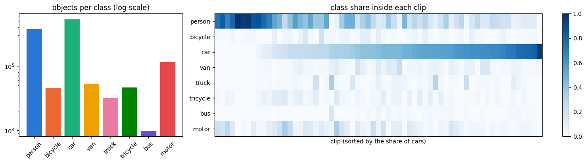

2. Objects are really tiny, median is close to 24 px at a long side of the image = 1024. What we did: the input size = 1024, also later tested at 1280

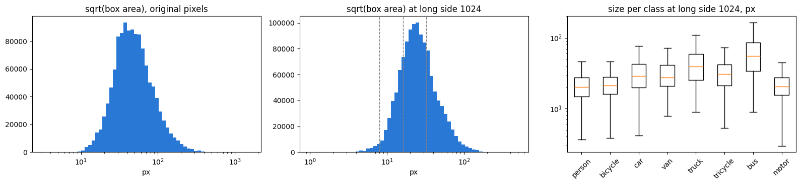

3. Number of objects: there are as much as 180 objects in one frame, so the usual limit of 100 detections would cut real objects, and 500 is the limit that the competition metric uses
4. Similarity of frames: most of the frames are similar with very small change, an example: a same objects 0.89 of itself after 1 frame, at 2 frames it is 0.81, and 0.35 by every 10th, so, we trained on every 10th frame of clip

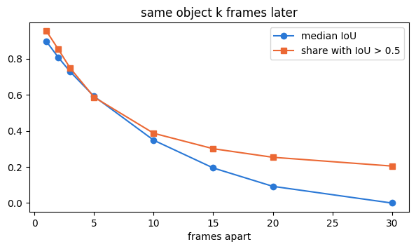

### Ignored regions:
We painted the ignored regions to gray, so that the model wouldn't be puhished if it found objects in that region, and also, in evaluation marked it with iscrowd so that the detection does not counts the objects there. Also labels that are more than half inside an ignored region were removed from training

### Label conversion

Labels were converted to YOLO format, and all frameworks used them
They were checked by drawing the boxes back on frames

### Resizing:
For torchvision modelseach frame is scaled so its longer side is 1024 pixels, and the shorter side is resized in proportion, so the aspect ratio stays the same.

YOLO uses letterbox (the frame is scaled down to fit inside a 1024 square, and the empty strips are filled with gray). RT-DETR at prediction stretches the frame to a 1024 square, without gray strips.

## Validation:
We validated on the whole clips the model never saw during training. We did it because frames from one clip look almost the same, so if we wuild split by frame, the model would see frames almost identical to training clips during validation. The test set is made of new clips too, so a split by clip copies the real situation.

### Split
GroupKFold with 5 folds, grouped by clip, so each clip lands entirely in one fold. One fold  whose class shares were closest to the pther data, 
became the hold-out (13 clips, 5446 frames, evaluated on every 10th frame, which is 551 frames). For the final submission, the model was retrained on all 63 clips.

### Evaluation
For evaluation we used COCO mAP. The evalutaion scores were assigned with use he original frame size, so every model is judged the same way, doesnt matter what input size it used.

### Decision to leave the change: 
We did only one change at a time, kept only if hold-out mAP went up. The seed noise is 0.0067 mAP, so smaller gain of a training change could have been just a lucky thing. Inference changes use the same trained weights, so they have no seed noise.

## Models

### Two-stage Anchor-based
Faster R-CNN.
We have chosen the ResNet-50 FPN v2, in a nutshell it works in 2 stages: first it proposes regions, and than in the 2nd stage it classifies them

Baseline was 0.2339, and after trying different approaches we chose adding more RPN proposals and GIoU loss, that gave the mAP if 0.2451

The problem with it was that 26% of small objects were never proposed in the first stage, so they were skipped by model right away

| Run | mAP | AP50 | AP small | ms per frame |
|---|---|---|---|---|
| Baseline | 0.2339 | 0.4600 | 0.0394 | 116 |
| More RPN proposals (kept) | 0.2409 | 0.4706 | 0.0431 | 165 |
| 50 % positive RoIs (dropped) | 0.2373 | 0.4731 | 0.0433 | 165 |
| GIoU loss (kept) | 0.2451 | 0.4881 | 0.0502 | 165 |

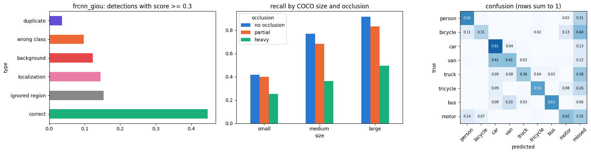

### One-stage Anchor-based

We have chose the RetinaNet (ResNet-50 FPN v2). It is one stage Anchor-based model, so it uses anchors + focal loss, and has no proposal stage. It is the worst of 4 models, the baseline was 0.1790, and it was its best result. 

We tried several approaches: anchors fitted to the data, lower IoU, thresholds and NWD loss and all made it worse.

| Run | mAP | AP50 | AP small |
|---|---|---|---|
| Baseline (best) | 0.1790 | 0.3388 | 0.0261 |
| Anchors from data, 16 to 256 px | 0.1368 | 0.3029 | 0.0354 |
| Lower IoU thresholds 0.4 / 0.3 | 0.1454 | 0.2704 | 0.0189 |
| NWD loss | 0.1763 | 0.3403 | 0.0234 |

The problem with it is that it finds only 19 percent of small objects against 40% for Faster R-CNN.

### One-stage Anchor-free

For this we have Chosen YOLO26m. It is one stage, anchor free, and fast, only 34ms per frame on one T4 GPU with batch 1

Results: Baseline was 0.2710 at 1024 size. Input 1280 raised it to 0.3074, the P2 head gave only 0.2777 and was slower.

| Run | mAP | AP50 | AP small | ms per frame |
|---|---|---|---|---|
| Baseline 1024 | 0.2710 | 0.5166 | 0.0628 | 34 |
| Input 1280 (kept) | 0.3074 | 0.5770 | 0.0825 | 55 |
| P2 head | 0.2777 | 0.5532 | 0.0773 | 78 |

The problem with it, is that in input size 1024, 70% of objects were smaller that one grid cell at stride 32 (32px), but only 1.7% were smaller than a cell at stride 8, that is why the extra P2 head did not help much

### Query-based

For this we have chosen RT-DETR-l. It is a transformer detector: it ahs a CNN backbone, than a transformer decoder with set of querries, and each querry than predicts at most one object. During training its predictions are being matched to objects on to one, so there are only 1.9 % duplicates, thats why it doesn't use NMS at all.

Results: Baseline with 300 queries: 0.3109, 500 queries: 0.3123, 500 queries + 500 denoising queries: 0.3170, the best of all four models

| Run | mAP | AP50 | AP small | ms per frame |
|---|---|---|---|---|
| Baseline, 300 queries | 0.3109 | 0.5777 | 0.0852 | 101 |
| 500 queries | 0.3123 | 0.5826 | 0.0875 | 101 |
| 500 queries + 500 denoising queries | 0.3170 | 0.5949 | 0.0929 | 102 |

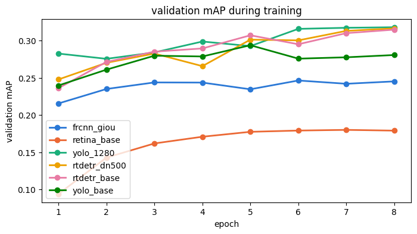

## Our pipeline
The idea was to use RT-DETR to find the boxes, and than the metamodel that will decide how much to trust each box using the neighbour frames and agreement with other models.

The realization of our pipeline is following:

- Input: test frames are being resized so that theirs long side is 1280
- Detection: RT-DETR-l (500 queries, 500 denoising queries, trained on all 63 clips)
- Other detectors: Faster R-CNN, RetinaNet and YOLO also run on the same frame. For each RT-DETR box, we recorded whether they found the same object and with what score.
- Temporal features: we used RT-DETR boxes on whole clip and than linked them into tracks with Hungarian matching on IoU. Each box gets the track mean score over window of 10 frams and short gaps in tracks are filled.
- Metamodel: we have trained the metamodel (we chose te simpliest logistic regression) that takes features of each box and than outputs the final score the score of RT-DETR, temporal score, and scores from other detectors
- Two final variants: submission_meta_noyolo.csv uses the RT-DETR score, track features and Faster R-CNN features, submission_meta.csv uses the scores of all detectors (RT-DETR, temporal, YOLO, Faster R-CNN, RetinaNet)
- Ouput: boxes are scaled back to the original frame size and written to the submission file

## Results

### All detectors under the shared protocol

Hold-out mAP 0.50:0.95 on 551 frames of 13 clips, input 1024 (YOLO 1280), 8 epochs, ms per frame at fp32, batch 1.

| Model | mAP | AP50 | AP small | AP medium | AP large | ms per frame |
|---|---|---|---|---|---|---|
| Faster R-CNN, GIoU | 0.2451 | 0.4881 | 0.0502 | 0.2244 | 0.3523 | 165 |
| RetinaNet, baseline | 0.1790 | 0.3388 | 0.0261 | 0.1529 | 0.2828 | 69 |
| YOLO26m, input 1280 | 0.3074 | 0.5770 | 0.0825 | 0.3036 | 0.3919 | 55 |
| RT-DETR-l, dn500 | 0.3170 | 0.5949 | 0.0929 | 0.3052 | 0.4151 | 102 |

AP per class:

| Model | person | bicycle | car | van | truck | tricycle | bus | motor |
|---|---|---|---|---|---|---|---|---|
| Faster R-CNN | 0.216 | 0.084 | 0.459 | 0.233 | 0.194 | 0.242 | 0.402 | 0.134 |
| RetinaNet | 0.162 | 0.029 | 0.429 | 0.094 | 0.093 | 0.118 | 0.436 | 0.073 |
| YOLO26m | 0.275 | 0.107 | 0.513 | 0.281 | 0.245 | 0.321 | 0.508 | 0.213 |
| RT-DETR-l | 0.257 | 0.135 | 0.526 | 0.316 | 0.270 | 0.300 | 0.538 | 0.200 |

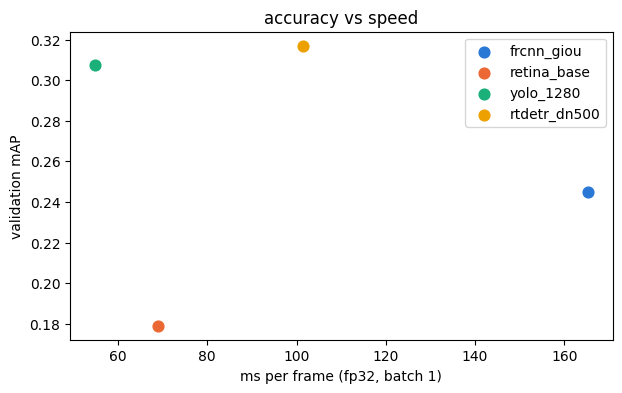

### Pipeline experiments

| Step | Type of change | Hold-out mAP | Public score | Private score | Kept |
|---|---|---|---|---|---|
| RT-DETR dn500 (start point) | model | 0.3170 | - | - | yes |
| Every 5th frame instead of every 10th | data | 0.2904 | - | - | no |
| 2 times more epochs | training | 0.3065 | - | - | no |
| Lower lr 1e-4 and smaller effective batch (base already used AdamW) | training | 0.2735 | - | - | no |
| Train at 1280 | data | 0.3234 | - | - | no |
| RT-DETR-X | model | 0.3194 | - | - | no |
| Train at 1024, predict at 1280 | inference | 0.3325 | 0.3397 | 0.2814 | yes |
| Multi-scale test (WBF) | inference | 0.3254 | - | - | no |
| Multi-scale + flip test (WBF) | inference | 0.3274 | - | - | no |
| + temporal rescoring | inference | 0.3380 | 0.3441 | 0.2803 | yes |
| + YOLO ensemble (NMS) + temporal | inference | 0.3431 | 0.3356 | 0.2864 | no |
| Self-training control, no pseudo-labels | data | 0.3171 | - | - | no |
| Self-training with pseudo-labels + temporal | data | 0.3239 | - | - | no |
| Ridge metamodel | model | 0.3267 (out of fold) | - | - | no |
| Logistic metamodel, all detectors | model | 0.3416 (out of fold) | 0.3516 | 0.2905 | yes |
| Logistic metamodel, without YOLO | model | 0.3397 (out of fold) | 0.3537 | 0.2957 | yes |

Metamodel weights (standardized features):

| Feature | Weight |
|---|---|
| Temporal track score | 0.97 |
| RT-DETR score | 0.59 |
| YOLO agreement | 0.45 |
| Faster R-CNN agreement | 0.20 |
| RetinaNet agreement | 0.12 |

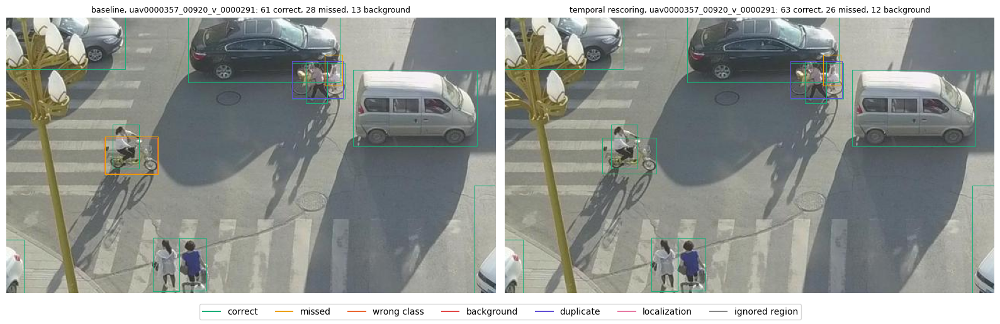

### Final submissions

| File | Hold-out mAP | Public score | Private score |
|---|---|---|---|
| submission_meta_noyolo.csv | 0.3397 | 0.3537 | 0.2957 |
| submission_meta.csv | 0.3416 | 0.3516 | 0.2905 |

## Run instructions

All code is in one notebook, `Botsko_Antoniuk_lab2.ipynb`, and it runs from top to bottom.

### Environment
- Kaggle notebook with GPU T4 x2 and internet turned on
- the competition dataset attached as input, the notebook finds it by `test_images.csv`
- tested with Python 3.13, torch 2.11.0 (CUDA 12.8) and the other packages of the Kaggle image (numpy, pandas, scikit-learn, scipy, matplotlib)

### Dependencies
Installed by the notebook itself:
- `ultralytics==8.4.190`, `pycocotools` in the first cell
- `kaggle==2.2.5`, only when earlier runs are restored
- `ensemble-boxes==1.0.9`, in section 7.6

### Settings and seeds
All shared settings are in the second cell:
- input size 1024, 8 epochs, every 10th frame for training and validation
- score threshold 0.001, NMS IoU 0.6, at most 500 detections per frame
- seed 42 for Python, NumPy, PyTorch and all Ultralytics trainings; seed 1 only in the seed noise run of B3

### Running across several sessions
The whole notebook needs more GPU time than one Kaggle session, so it is resumable:
- every run saves its weights, predictions and metrics to `ai-hw2/<run name>/`, and finished runs are skipped
- no new training starts after 7 hours of a session (`TIME_LIMIT_H`)
- `PREV_KERNEL` points to the previous notebook version (`starezax20/notebookd0ef990b98/17`), and its `ai-hw2/` output is copied in at the start, this needs the Kaggle secret `KAGGLE_API_TOKEN`
- for a run from scratch set `PREV_KERNEL = ''`
- to continue: Save Version, Save & Run All, then set `PREV_KERNEL` to the new version and run again until all sections finish

### Submission files
Written to `/kaggle/working`:

| File | Section |
|---|---|
| submission.csv | 7.4 Final model and submission |
| submission_pipeline.csv | 7.6 Test time augmentation and ensemble with YOLO |
| submission_meta.csv, submission_meta_noyolo.csv (final) | 7.8 Metamodel submission |
| submission_temporal.csv | B1 Temporal submission |

## Additional tasks

### Data temporality

Method:
Detections of the same class are linked across neighbouring frames into tracks using Hungarian matching on IoU, with gaps of up to 2 frsmes. Then, we update boxes' scores as 0.7 × its own score + 0.3 × the mean score of its track over ±10 frames (frames with no detection count as 0). This way we try to raise weak boxes that belong to long tracks while lowering the boxes that appear in only one frame. We filled gaps in track with interpolated boxes. We also didn't compensate for camera motion because in the EDA the same object has an IoU of 0.89 with itself one frame later, so we decided that plain IoU matching is enough.

There are two versions: 
causal - uses only previous frames
bidirectional - uses both previous and next frames. 

We tuned the method on one half of the hold-out clips and tested it on the other half, then swapped the halves. Score went from 0.3536 to 0.3551 in one direction, and from 0.3173 to 0.3298 in the other.

| Variant | mAP | AP50 | AP small | correct at score 0.3 | background at score 0.3 | Public | Private |
|---|---|---|---|---|---|---|---|
| No rescoring | 0.3325 | 0.6128 | 0.0904 | 40.1 % | 16.5 % | 0.3397 | 0.2814 |
| Causal | 0.3357 | 0.6195 | 0.0911 | 43.7 % | 14.9 % | - | - |
| Bidirectional + gap fill | 0.3380 | 0.6237 | 0.0924 | 44.1 % | 14.7 % | 0.3441 | 0.2803 |

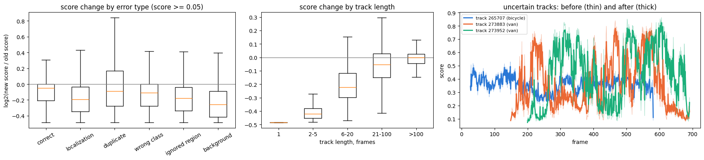

Findings:
* 297341 tracks on the 5446 hold-out frames, 56 % longer than one frame, median length 5 frames
* causal version is weaker than bidirectional in every setting
* main effect is removing false positives: at score 0.3 background boxes drop from 7054 to 5638, only 58 objects are recovered and 315 lost
* background boxes are boosted in 14 % of cases, correct boxes in 23 %
* vans (0.327 -> 0.343) and tricycles (0.324 -> 0.337) gain most
* public score went up, private score went slightly down, so the gain on the test clips is within noise
* the temporal score became the strongest feature of the metamodel (weight 0.97)

### Visualization

Model: Faster R-CNN (GIoU) as its RoI features and backbone stages are easy to access.

All training curves, configurations, validation predictions with boxes and the visualizations are logged to W&B: [wandb.ai/arsen7047-ukrainian-catholic-university/ai-hw2](https://wandb.ai/arsen7047-ukrainian-catholic-university/ai-hw2)

We ran t-SNE on the RoI head features of 4,165 ground-truth objects from 120 validation frames. Vehicles form one group and persons and two-wheelers form another. Object size changes smoothly across the map. As the result, persons and cars are well separated, as 90% of their nearest neighbours belong to th same class. However, the other classes overlap more. Bicycles mix with motors (46% of neighbours), vans with cars (28%) and buses with vans (27%). Overall, 69% of objects are detected. And another 25% are missed because the head predicts the wrong class or background even when the box is correct. And only 5% are missed while the head’s prediction is right.

| Size | Objects | Head accuracy with true box | Detector recall |
|---|---|---|---|
| small | 697 | 51 % | 44 % |
| medium | 2896 | 70 % | 72 % |
| large | 572 | 83 % | 87 % |

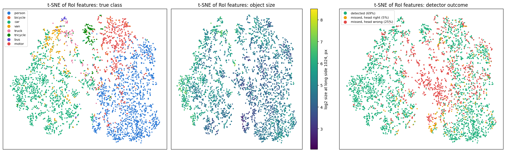

We computed Grad-CAM of the detection score on the 4 backbone stages for 232 detections and measured what share of each map falls inside box. This share is close to what a uniform map would give, and so backbone uses a lot of context around the object. Small objects get the highest share at stride 4 and the lowest at stride 32 while large objects get the highest share at stride 16. The stride 32 stage looks mostly outside the box for every type of detection. Boxes with the wrong class have the highest share inside the box, which means the model looks at the right object however still confuses similar classes. Overall, we can say that small objects are missed mainly because their features are weak, and not only because the RPN doesn’t propose them.

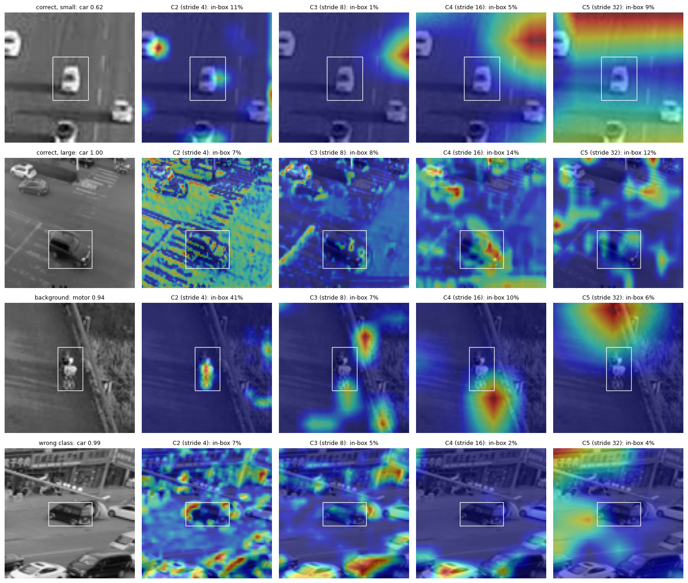

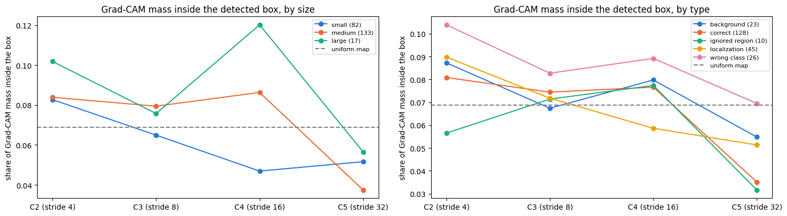

### Custom architectural decisions

Baseline: RT-DETR-l with 500 queries and 500 denoising queries (0.3170). Every change trained under the shared protocol, starting from COCO weights copied into the new layers where shapes match.

Motivation: 70 % of objects are smaller than one stride 32 cell, however, decoder onlyn samples P3 to P5 (stride 8 to 32) and never the stride 4 level.

A1, decoder depth without retraining (the decoder is stopped after k layers):

| Layers | 1 | 2 | 3 | 4 | 5 | 6 |
|---|---|---|---|---|---|---|
| mAP | 0.2966 | 0.3067 | 0.3081 | 0.3111 | 0.3134 | 0.3170 |
| ms per frame | 84.8 | 88.1 | 90.6 | 94.3 | 97.8 | 101.2 |

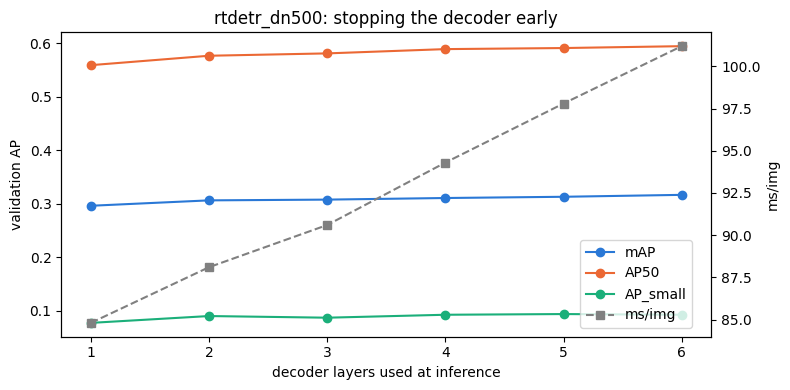

A2, which feature level the queries and correct detections come from:

| Level | Feature tokens | Selected queries | Correct detections |
|---|---|---|---|
| P3 (stride 8) | 76 % | 51 % | 25 % |
| P4 (stride 16) | 19 % | 10 % | 0 % |
| P5 (stride 32) | 5 % | 40 % | 75 % |

- objects below 16 px are found from P3 in 86 % of cases, objects above 32 px almost only from P5

Experiments:

| Run | Change | mAP | AP small | Recall < 16 px | mAP dense | Params, M | GFLOPs | ms | Kept |
|---|---|---|---|---|---|---|---|---|---|
| Baseline, seed 42 | - | 0.3170 | 0.093 | 58 % | 0.345 | 32.8 | 278 | 101 | - |
| E1 baseline, seed 1 | seed noise | 0.3237 | 0.091 | - | - | 32.8 | 278 | 101 | noise 0.0067 |
| E2 P2 to P4 | add P2, remove P5 | 0.3118 | 0.074 | 51 % | 0.364 | 35.2 | 733 | 210 | no |
| E3 P2 to P5 | add P2 | 0.3052 | 0.081 | 56 % | 0.342 | 38.2 | 740 | 214 | no |
| E4 5 decoder layers | remove 1 layer | 0.3135 | 0.087 | 60 % | 0.344 | 31.7 | 274 | 98 | yes |
| E5 5 layers, input x1.25 | final architecture | 0.3216 | 0.086 | - | - | 31.7 | 274 | - | no, below 0.3325 |

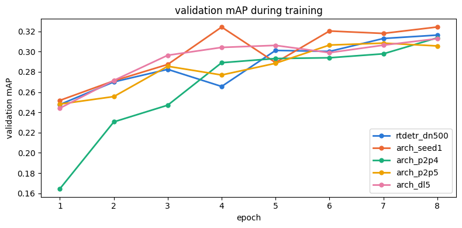

Findings:
- the seed noise (0.0067) is larger than most of the architecture effects
- with P2 small objects move to P2 (96 % of objects below 16 px) but their recall drops and also compute is 2.6 times higher
- P2 to P4 starts at 0.165 after the first epoch as new layers are not pretrained, and only catches up by epoch 8, so 8 epochs is not enough forthis
- P2 to P4 is the best on dense frames (0.364 against 0.345)
- the 5 layer decoder stays within the noise with fewer parameters and is faster, so one decoder layer can be removed
- failure cases of the final architecture are the same as the baseline: 39 % correct, 22 % in ignored regions, 16 % background at score 0.3, vans taken for cars (32 %) and bicycles for motors (32 %)
- no change beat the final model at its best input size, so the final model was not replaced

